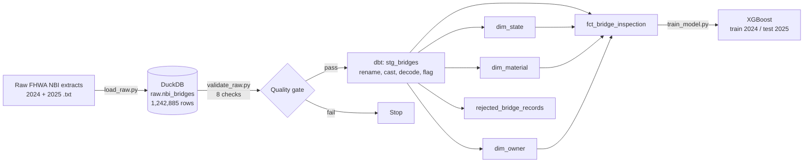
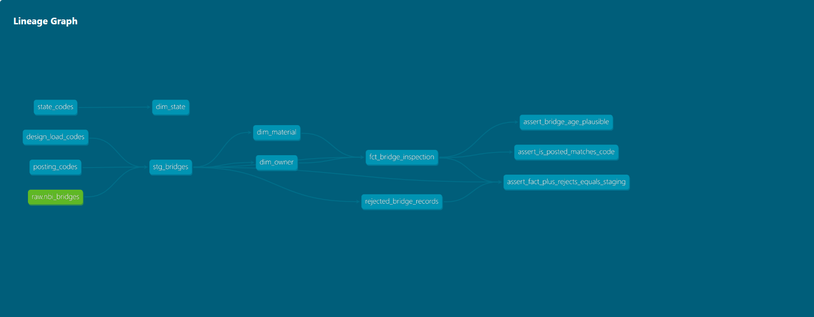

# Bridges-NBI-Analysis

**Predicting U.S. bridge load-posting status from the National Bridge Inventory: a tested ELT pipeline (DuckDB + dbt + Airflow) feeding an XGBoost model, plus the original PySpark analysis**

The project has two parts:

1. **Data pipeline (Oct 2026):** raw FHWA files → DuckDB → a dbt star schema with 47 data tests → an XGBoost model, orchestrated as an Airflow DAG.
2. **Spark analysis (AIT 614 course project):** PySpark feature engineering and model comparison on 950K+ records, with MongoDB and Databricks SQL.

---

## Part 1: Data pipeline

### Architecture



It's **ELT**: the raw files are loaded into the warehouse unchanged (every column as text), and all cleaning happens inside the warehouse in SQL with dbt. The raw table always stays a faithful copy of what FHWA delivered.

### Star schema

**Grain of the fact table:** one bridge (state code + structure number) per inspection year.

| Table | Type | Rows | What it holds |
|---|---|---|---|
| `fct_bridge_inspection` | Fact | 1,242,865 | Year built, age, max span, daily traffic, truck %, design load, posting code, `is_posted` |
| `dim_state` | Dimension | 53 | FIPS code, abbreviation, name (50 states + DC, PR, VI) |
| `dim_material` | Dimension | 10 | Main-span material (NBI Item 43A) + material family |
| `dim_owner` | Dimension | 36 | Owning agency (NBI Item 22) + government level |
| `rejected_bridge_records` | Quality report | 3 rows | Raw records kept out of the fact table, by reason and year |

Code lookups (posting codes, design-load codes, state FIPS codes) are dbt **seeds**: small CSVs version-controlled with the project.



### Data quality

**47 dbt tests, all passing**, plus an 8-check gate on the raw data before dbt runs.

| Test | What it protects |
|---|---|
| `unique` + `not_null` on every key | The fact grain really is one bridge per year; every dimension row is distinct |
| `relationships` (fact → each dimension) | Every foreign key points at a real dimension row |
| `not_null` on foreign keys | Catches rows that a `relationships` test silently skips (it ignores nulls) |
| `accepted_values` | Posting codes are 0–5, design-load codes match NBI Item 31, years are 2024/2025 |
| `assert_fact_plus_rejects_equals_staging` | Reconciliation: no row is lost silently between staging and the marts |
| `assert_is_posted_matches_code` | The target label follows the NBI rule (posted = code 0–4) |
| `assert_bridge_age_plausible` (warn) | Flags typos in year built without blocking the build |

**What the checks found:**

- **Excel had corrupted bridge IDs in the original cleaned dataset.** The course version of this project went raw text → Excel → cleaned CSV. Excel stored 15-digit structure numbers as numbers and kept only about 6 significant digits (`1.00001E+14`), in **238,519 of 957,758 rows (25%)**. Distinct bridges ended up sharing an ID, so de-duplication dropped real records. The pipeline now reads the raw FHWA text files directly, and `validate_raw.py` fails if any scientific-notation ID appears.
- **8 records share an ID with a different physical bridge** in the same year (different year built), so neither record can be trusted. **12 records have no posting code.** Both groups are quarantined in `rejected_bridge_records`, not dropped silently.
- **21 bridges have no owner agency.** The `not_null` test on `owner_key` caught them. They're mapped to NBI's existing "Other or Unknown" owner category rather than dropped.

### Model results

`train_model.py` reads the star schema and trains XGBoost on the **2024** inspection year, then tests on **2025**. The split is by year because the same bridge appears in both years, so a random split would leak test bridges into training.

| Metric | Value |
|---|---|
| Train / test rows | 618,688 / 624,177 |
| Test base rate (posted) | 9.07% |
| ROC-AUC | **0.955** |
| PR-AUC | **0.677** |
| Recall @ 0.5 | 0.916 |
| Precision @ 0.5 | 0.411 |

Class imbalance is handled with `scale_pos_weight` (≈10). Top features: design load, owner level, material family.

**Limitation:** most 2025 bridges were also in the 2024 data, so this measures "predict next year's posting status for known bridges", which is easier than predicting for bridges the model has never seen. These numbers come from a different pipeline and dataset than the Spark results in Part 2, so the two shouldn't be compared directly.

### Orchestration (Airflow)

`dags/nbi_pipeline_dag.py` runs `load_raw → validate_raw → dbt_build → train_model`:

- every task is a shell command, so each step can also be run by hand
- `retries=2` with a 1-minute delay for transient failures; `validate_raw` has no retries, because bad data doesn't fix itself
- if validation fails or any dbt test fails, the task exits non-zero and every downstream task is skipped, so bad data never reaches the model
- every step is **idempotent**: tables are rebuilt with `CREATE OR REPLACE`, so re-running gives the same result

### How to run

```bash
pip install -r requirements-pipeline.txt

# Folder holding the raw FHWA extracts (2024_part1.txt, datasetfinal_2025.txt)
export NBI_RAW_DIR=/path/to/raw          # PowerShell: $env:NBI_RAW_DIR = "C:\path\to\raw"

python pipeline/load_raw.py              # raw files -> warehouse/nbi.duckdb
python pipeline/validate_raw.py          # quality gate (exit 1 on failure)
cd nbi_dbt
dbt build --profiles-dir .               # seeds, models and all 47 tests
dbt docs generate --profiles-dir .       # lineage + docs (dbt docs serve to view)
cd ..
python pipeline/train_model.py           # metrics -> results/pipeline_model_metrics.json
```

Airflow (Linux, macOS or WSL): set `NBI_PROJECT_DIR` and `NBI_RAW_DIR`, put `dags/` in your Airflow DAGs folder, and trigger `nbi_bridge_pipeline`. To run it once without the scheduler: `airflow dags test nbi_bridge_pipeline`.

---

## Part 2: Spark analysis (course project)

PySpark analysis of **956,254** cleaned NBI records (2024–2025) from AIT 614, Big Data Essentials.

- **Feature engineering:** 26 features (7 base, plus interaction terms such as age×truck and span×truck, polynomial terms and categorical encodings)
- **Class imbalance:** 874,550 not posted vs. 81,704 posted (base rate 8.5%), handled with inverse-frequency sample weights
- **Models compared:** Logistic Regression, Decision Tree and XGBoost, with manual hyperparameter tuning
- **Best model (tuned XGBoost):** ROC-AUC **0.937**, recall **0.89**, precision ≈0.33, PR-AUC 0.619
- **Storage and BI:** cleaned data loaded into MongoDB; 6 Databricks SQL visualizations in `results/visualizations/`

That analysis used the Excel-based cleaned CSV described above. Its model features don't use the structure number, but its row count was affected by the ID corruption that Part 1 fixes.

Run it: open `notebooks/bridge_posting_model.ipynb` (PySpark 3.5, Java 17) and point `DATA_PATH` at the cleaned CSV produced by `src/clean_nbi_data.py`. Databricks queries are in `sql/databricks_queries.sql`, MongoDB notes in `docs/MongoDB_Integration.md`, and the full write-up in [`docs/technical_report.pdf`](docs/technical_report.pdf).

---

## Repository structure

```
Bridges-NBI-Analysis/
├── pipeline/                  # load_raw.py, validate_raw.py, train_model.py
├── nbi_dbt/                   # dbt project (models/, seeds/, tests/)
├── dags/nbi_pipeline_dag.py   # Airflow DAG
├── requirements-pipeline.txt  # pipeline dependencies
├── notebooks/                 # PySpark analysis (Part 2)
├── src/clean_nbi_data.py      # original pandas cleaning script (Part 2)
├── sql/databricks_queries.sql # Databricks SQL visualizations
├── results/                   # model metrics + visualizations
├── docs/                      # lineage graph, technical report, MongoDB notes
└── data/README.md             # data source and download notes
```

## Data source

U.S. Federal Highway Administration, [National Bridge Inventory](https://www.fhwa.dot.gov/bridge/nbi.cfm), 2024 and 2025 (public domain). Raw files aren't committed; see `data/README.md`.

## Author

**Sai Praneet Reddy Chinthala**, M.S. Data Analytics Engineering, George Mason University
[praneetreddy66@gmail.com](mailto:praneetreddy66@gmail.com) · [GitHub @praneetreddy3](https://github.com/praneetreddy3)

## License

MIT (see `LICENSE`). NBI data is public domain.
